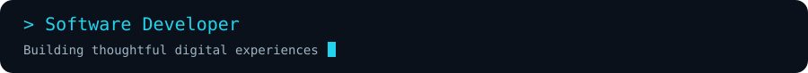
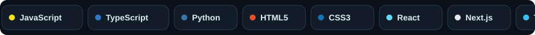

# Santiago Taylor

**Software Developer** · Full Stack Development · Software Architecture

## About me

I'm Santiago, a software developer interested in creating thoughtful, useful digital experiences. I enjoy exploring how frontend development, backend systems, and software architecture come together to build well-structured applications.

My current interests include **full stack development**, **DevOps**, **frontend engineering**, and **software architecture**. I value continuous learning, clear code, and improving the way I design and build software.

## Tech stack

  

<b>View technologies as text</b>

**Languages:** JavaScript · TypeScript · Python · HTML · CSS  
**Frontend:** React · Next.js · Tailwind CSS · Bootstrap  
**Data & tooling:** PostgreSQL · Prisma · Git · GitHub · Docker  
**Platforms & design:** Linux · AWS · Figma

## Featured projects

<table>
<tr>
<td width="50%" valign="top">

### [Co-Space](https://github.com/santiagotaylor543221-crypto/co-space)

A project in my personal GitHub account. Explore the repository for its implementation, technologies, and current status.

[View repository](https://github.com/santiagotaylor543221-crypto/co-space)

</td>
<td width="50%" valign="top">

### [Otium](https://github.com/complejo-deportivo-dev/complejo-deportivo)

A project hosted in a separate GitHub organization. Explore the repository for its implementation, technologies, and current status.

[View repository](https://github.com/complejo-deportivo-dev/complejo-deportivo)

</td>
</tr>
</table>

## Currently exploring

- Building stronger foundations in **software architecture** and **full stack development**.
- Learning more about **DevOps workflows** and developer tooling.
- Improving how I design and implement user-facing experiences.

## GitHub activity

### Contribution trail

> The contribution animation will appear after the GitHub Actions workflow runs successfully for the first time.

## Beyond code

When I'm away from the keyboard, you'll probably find me enjoying **coffee**, playing **football**, or training **boxing**. ☕ ⚽ 🥊

## Let's connect

I'm always happy to connect with other developers, exchange ideas, and learn from interesting projects.

**[LinkedIn](https://www.linkedin.com/in/santiago-taylor-52b330442/)** · **[Email](mailto:santiago.taylor.dev@gmail.com)**

